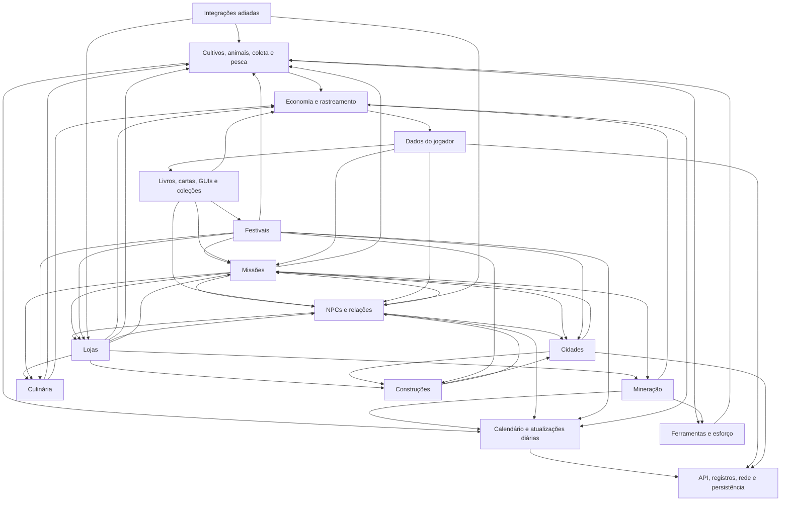

# Dependências entre sistemas

Auditoria de 30/10/2026. **Aprovado pelo usuário em 30/10/2026.** A Fase 1 foi posteriormente autorizada e seu esqueleto validado; os pacotes permitidos continuam definidos em `STATUS.md`. A aprovação do grafo não autoriza antecipar sistemas das próximas fases. A distribuição permanece em mod único conforme `AGENTS.md`.

## Leitura do grafo

`A --> B` significa **A usa B**, e não ordem de inicialização. O original contém ciclos e acesso indireto por `HFApi`/`HFTrackers`; portanto não existe uma ordenação topológica de todos os pacotes atuais. `LoadOrder` ordena registros, não elimina dependências de execução. O grafo abaixo resume relações funcionais; a matriz de imports ao final complementa com acoplamentos estáticos, inclusive de renderização e inicialização.

Os subsistemas também usam a base compartilhada; essas arestas repetidas foram omitidas do desenho. O nó produção é uma abreviação visual, não uma proposta de pacote único.

## Evidências e consequências

| Sistema consumidor | Dependências funcionais e evidência no original |
| --- | --- |
| Núcleo/API | `HFTrackers` referencia calendário, jogadores, cidades, animais e minas; `HFCore` registra blacklist de presentes. O núcleo atual não é independente. Contratos e utilitários precisam ser distinguidos dos registros de conteúdo. |
| Calendário | `CalendarServer`/handlers coordenam novo dia; `CalendarHUD` consulta ouro; `HFFestivals` importa construções, animais, culinária, notas e missões. Separar relógio básico de festivais na sequência de portagem. |
| Jogador/economia | `PlayerTrackerServer` contém missões, relações, cartas, estatísticas e rastreamento; `newDay` paga remessas e atualiza relações/cartas. `TileShipping` e `ShippingRegistry` usam dados do jogador. |
| Cultivos | `HFCrops` registra ingredientes, alimentação e preços; `TileCrop` usa calendário/rega; `SpecialRulesYear`/`SpecialRulesRanch` ligam sementes à cidade. |
| Ferramentas | `ItemHoe`/`ItemWateringCan`/`ItemSickle` operam cultivos; `ItemHammer`/`ItemAxe` operam recursos; `HFTools` inclui varas de `HFFishing`. Melhorias/reparo/bênção são serviços de missões/NPCs. |
| Animais | `AnimalStatsHF` usa clima, relações e atualizações diárias; ração/forragem vem de cultivos; produtos usam tamanhos/preços/culinária e concursos. |
| Coleta | `GatheringDaily` e `HFGathering` usam estações, blocos compartilhados e ferramentas de quebra; materiais entram em receitas, lojas e missões. |
| Pesca | `ItemFishingRod` depende da base de ferramentas; `FishingAPI`/loot usam estações, horários e níveis; criatório usa atualização diária. Peixes alimentam cozinha, remessas e missões. |
| Mineração | `MiningDaily` usa estação/dia; `MiningHelper` usa ferramentas, loot, rastreamento e teleporte; `MineManager` persiste a distribuição das minas. Animais sombrios reutilizam conteúdo animal. |
| Culinária | `HFIngredients`/`HFRecipes` unem cultivos, produtos animais, coleta e peixes; `CookingHelper`/livro usam receitas aprendidas. Geladeira e utensílios reutilizam inventários/renderização do núcleo. |
| Cidades/construções | `TownDataServer` mantém edifícios, missões e festivais; `HFBuildings` referencia NPCs; `PlaceableNPC`/`PlaceableMoveIn` e `EntityAIBuild` fecham o ciclo cidade–construção–NPC. |
| NPCs/relações | `HFSchedules` usa calendário e locais de edifícios; saudações consultam missões/lojas; `GiftRegistry` e `HFGifts*` usam produtos dos vários sistemas e relações do jogador. |
| Lojas | `HFShops` reúne NPCs, edifícios, cultivos, animais, materiais, receitas e varas; requisitos consultam calendário, amizade, missões e histórico de obtenção/remessas. |
| Missões | `QuestDataServer` funciona sob jogador ou cidade; missões concretas usam todos os sistemas produtivos, NPCs, lojas e construções. Separar motor de missões de catálogo/recompensas permite iniciar antes do conteúdo completo. |
| Festivais | `HFFestivals`, `BuildingFestival` e `QuestContest*` unem calendário, cidade, estruturas, animais, culinária, cartas e lojas sazonais. É uma das últimas fatias de conteúdo. |
| Conhecimento/interfaces | `GuiStats`, páginas de coleções e relações consultam os sistemas respectivos; cartas podem aceitar missões. GUIs específicas devem acompanhar a fatia do sistema proprietário, e não esperar uma fase única de interface. |
| Integrações | `plugins` adapta APIs externas aos registros internos: Aquaculture → pesca/cozinha/lojas; BOP → cultivos/coleta/cozinha; IE → cultivos/receitas externas; Blood Magic → lojas/NPCs; CraftTweaker → registros; Buttons/Morpheus → calendário/sono (comentados). Todas adiadas. |

## Ordem sugerida de portagem

Esta ordem propõe **fatias internas**, não a cópia sequencial dos pacotes acoplados. Cada futura tarefa precisa de critérios verificáveis e da fase autorizada.

1. **Fase 1, esqueleto:** confirmar combinação Minecraft/NeoForge/Java/Gradle; compilar e abrir o mod vazio.
2. **Contratos e infraestrutura sem dependências de gameplay:** identificadores, registros, configuração, tags/dados, serialização e rede. Evitar copiar o agregador `HFTrackers` como fundação monolítica.
3. **Dados básicos do jogador e relógio:** saldo, aniversário, data/estação, persistência, sincronização e notificação de novo dia; sem catálogos de festivais, missões ou relações completos.
4. **Economia básica e conteúdo compartilhado:** registro de preços, remessas, pagamento diário, cesta, flores e itens/blocos de apoio; validar salvar/reabrir mundo e pagamento uma única vez.
5. **Ferramentas mínimas + coleta:** ações e esforço, rochas/madeira e recursos sazonais; adicionar apenas os contratos necessários a cultivos e mineração.
6. **Cultivos + ferramentas agrícolas:** primeira fatia semente–plantio–rega–novo dia–colheita–remessa; depois demais cultivos, árvores e aspersores. Desbloqueios comerciais entram quando lojas/cidade existirem.
7. **Animais:** alimentação–dia–produção–remessa, reprodução e saúde; concursos ficam para festivais.
8. **Pesca:** vara–captura–remessa; depois armadilha/criatório. **Mineração:** dimensão–andar–minério–saída, depois elevador, renovação e criaturas sombrias. Ambas reutilizam ferramentas/dados; a ordem entre elas pode ser trocada após conferir seus registros de conteúdo.
9. **Culinária:** ingredientes já existentes, utensílios, preparo, geladeira e livro; obtenção de receitas por NPC ainda desacoplada do motor culinário.
10. **Contratos de cidade, edifícios, NPC e missão:** estabelecer referências por identificador e dados persistidos; fatia integrada de uma cidade, um edifício, um morador e um diálogo. O original exige resolver o ciclo, não escolher arbitrariamente um pacote inteiro primeiro.
11. **Relações, rotinas e lojas:** presentes/amizade, horários, compras com ouro/materiais e construção pelo carpinteiro; adicionar serviços de melhoria/reparo.
12. **Conteúdo de missões e progressão:** apresentações, tutorial, desbloqueios de cidade, amizade/receitas e pedidos recorrentes; ligar condições comerciais e ferramentas.
13. **Festivais completos:** cenários, convites, visitantes/lojas, concursos e recompensas; começar por um festival e validar restauração do cenário.
14. **Cobertura final:** coleções/notas/avanços e recursos de interface restantes, configurações e comportamento multiplayer. Persistência e UI essenciais já devem acompanhar cada fatia anterior.
15. **Integrações externas:** somente mediante solicitação explícita, na fase apropriada; não restaurar código comentado automaticamente.

## Prioridade aprovada para as fatias 19–21

Atualização posterior do responsável: executar apenas 19-A (Nabo Robusto), ampliada para ausência de estação no Nether/End em todos os cultivos HF. 19-B (nether wart HF, inclusive saco) adiada integralmente, preservando vanilla; decisões específicas reavaliadas se retomada. Esta revisão sucede o escopo da 19 no parágrafo abaixo, sem alterar 20-A/B/etc. nem início dos NPCs na 21.

O responsável definiu a sequência executiva: 19 para nabo de tutorial e nether wart, com escopo do prompt aprovado e ajustes de recorte compatíveis com esta sequência; 20 para concluir árvores frutíferas e aspersores em subfatias 20-A, 20-B etc.; desenvolvimento de NPCs iniciado na 21. Essa decisão prevalece sobre a ordem sugerida acima quanto ao início de NPCs: animais, pesca, mineração e culinária completos não são pré-requisitos gerais para começar esse trabalho.

O grafo estático permanece evidência das dependências originais. Antes de cada entrega, conferir os caminhos realmente consumidos e delimitar o mínimo necessário, particularmente o ciclo NPC–cidade–construções–missões. Não simular sistemas ausentes para forçar a nova ordem nem antecipá-los integralmente. Os subrecortes da 20 e o primeiro recorte concreto da 21 serão definidos após levantamento, com APIs verificadas, persistência e critérios de conclusão próprios. Novos pacotes concretos serão registrados em STATUS quando delimitados. A Fase 3 e as pendências existentes permanecem vigentes.

## Pontos de corte possíveis

| Corte hipotético | Contratos que precisariam atravessar a fronteira | Custo/limite |
| --- | --- | --- |
| Base + calendário/economia | Data, novo dia, jogador, remessas, tags e registros | Viável após remover dependências reversas de `HFTrackers`/registros. O núcleo original ainda conhece os consumidores. |
| Agricultura e pecuária | Rega, alimentação, produtos, tamanhos e calendário | Compartilham forragem, ferramentas, cozinha e concursos; separar requer adaptadores de conteúdo. |
| Pesca | Níveis de ferramenta, loot, espécies, receitas, preços | Corte relativamente localizado; loja, missões e cozinha precisam registrar integrações sem dependência circular. |
| Mineração | Dimensão/teleporte, ferramentas, materiais e progresso | Precisa desacoplar criaturas sombrias de animais e recompensas/serviços de NPCs. |
| Culinária | Ingredientes/receitas por dados, inventários e desbloqueios | Catálogo atual referencia diretamente outros sistemas; interfaces por tags permitiriam corte. |
| Vida na cidade | NPCs, construções, lojas, relações, missões e festivais | Forte componente cíclico; manter unido seria mais simples que separar um mod por pacote. |
| Compatibilidade externa | Registros públicos dos sistemas internos | Melhor fronteira para adaptadores opcionais; não exige vários mods. |

Estes cortes são análise arquitetural, não uma mudança da decisão de mod único nem aprovação para criar pacotes.

## Matriz de dependências estáticas observadas

Extraída dos imports ativos `joshie.harvest.*` de todos os arquivos Java do pacote consumidor, removendo comentários. Destinos são os primeiros segmentos abaixo de `joshie.harvest`; imports do próprio pacote foram omitidos. Não inclui acessos indiretos via `HFApi`, reflexão ou JSON e não é uma ordem de portagem. `raiz` indica classes como `HarvestFestival`.

| Pacote consumidor | Pacotes usados diretamente |
| --- | --- |
| `animals` | `api`, `calendar`, `core`, `raiz`, `tools` |
| `api` | `buildings`, `calendar`, `cooking`, `core`, `crops`, `npcs`, `raiz` |
| `buildings` | `api`, `core`, `mining`, `npcs`, `raiz`, `town` |
| `calendar` | `animals`, `api`, `buildings`, `cooking`, `core`, `knowledge`, `mining`, `npcs`, `quests`, `raiz`, `town` |
| `cooking` | `animals`, `api`, `core`, `crops`, `fishing`, `gathering`, `quests`, `raiz` |
| `core` | `animals`, `api`, `buildings`, `calendar`, `cooking`, `crops`, `fishing`, `knowledge`, `mining`, `npcs`, `player`, `quests`, `raiz`, `shops`, `tools`, `town` |
| `crops` | `api`, `buildings`, `calendar`, `core`, `gathering`, `raiz`, `shops`, `town` |
| `fishing` | `api`, `calendar`, `cooking`, `core`, `gathering`, `knowledge`, `npcs`, `raiz`, `tools`, `town` |
| `gathering` | `api`, `core`, `raiz`, `tools`, `town` |
| `knowledge` | `animals`, `api`, `buildings`, `calendar`, `cooking`, `core`, `crops`, `fishing`, `mining`, `npcs`, `player`, `quests`, `raiz`, `shops`, `tools`, `town` |
| `mining` | `animals`, `api`, `buildings`, `calendar`, `core`, `npcs`, `raiz`, `tools`, `town` |
| `mixin` | `api`, `fishing` |
| `npcs` | `animals`, `api`, `buildings`, `calendar`, `cooking`, `core`, `fishing`, `gathering`, `knowledge`, `mining`, `player`, `quests`, `raiz`, `shops`, `town` |
| `player` | `api`, `calendar`, `core`, `knowledge`, `npcs`, `quests`, `raiz`, `town` |
| `plugins` | `api`, `core`, `crops`, `raiz`, `shops` |
| `quests` | `animals`, `api`, `buildings`, `calendar`, `cooking`, `core`, `crops`, `fishing`, `gathering`, `knowledge`, `mining`, `npcs`, `player`, `raiz`, `shops`, `tools`, `town` |
| `shops` | `animals`, `api`, `buildings`, `calendar`, `cooking`, `core`, `crops`, `fishing`, `gathering`, `knowledge`, `mining`, `npcs`, `player`, `quests`, `raiz`, `tools`, `town` |
| `tools` | `animals`, `api`, `calendar`, `core`, `crops`, `fishing`, `raiz` |
| `town` | `api`, `buildings`, `calendar`, `core`, `gathering`, `knowledge`, `mining`, `npcs`, `quests`, `shops` |
